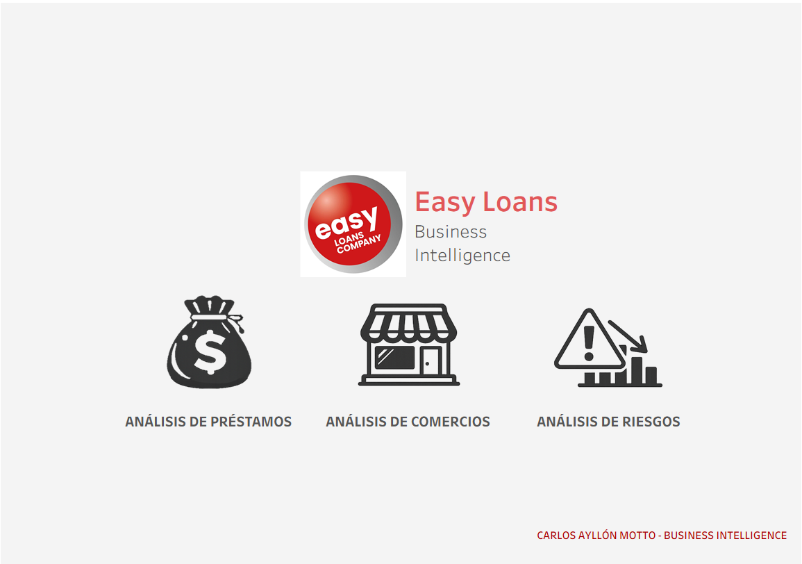
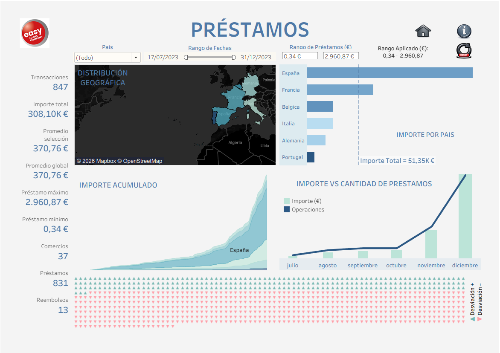
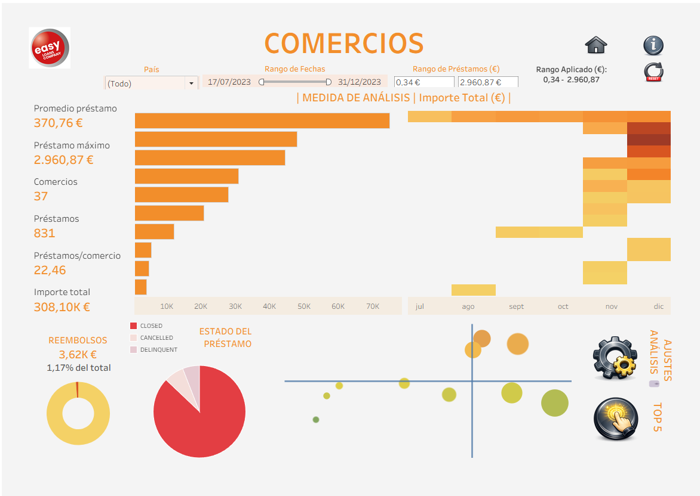
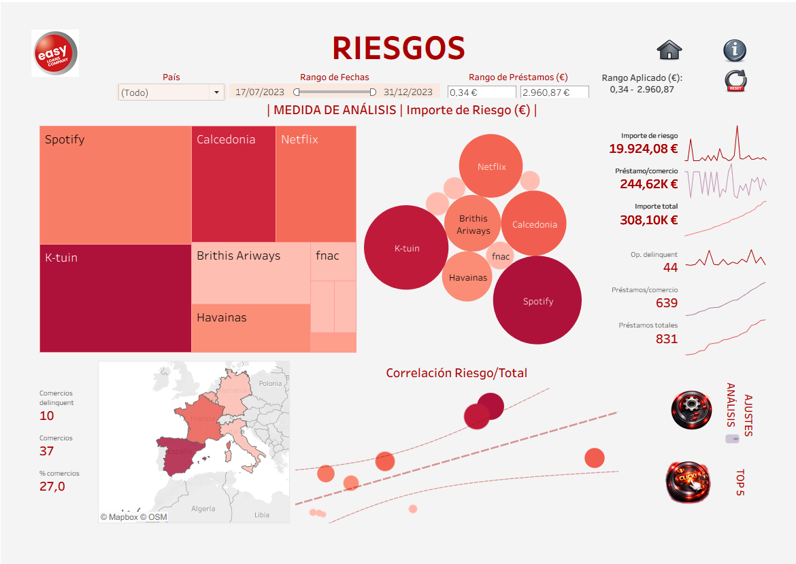
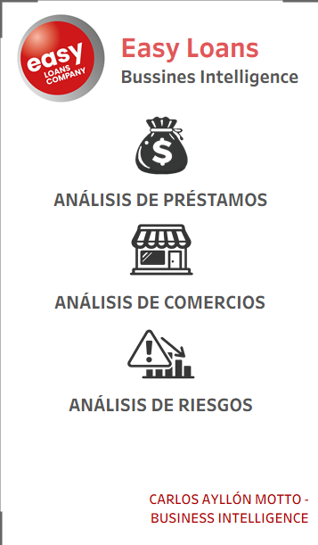
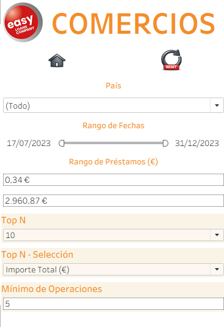

# Easy Loans · Business Intelligence con Tableau

Proyecto de **Business Intelligence y visualización de datos con Tableau** desarrollado sobre el caso ficticio **Easy Loans**, orientado al análisis de préstamos, comercios y riesgo.

<p align="center">
  <a href="https://public.tableau.com/app/profile/carlos.ayll.n/viz/Easy_Loans_Portfolio_PUBLIC/InicioEasyLoans">
    
  </a>
</p>

<p align="center">
  <strong>▶ Haz clic en la imagen para abrir el dashboard interactivo en Tableau Public</strong>
</p>

## Dashboard interactivo

**Tableau Public:**  
https://public.tableau.com/app/profile/carlos.ayll.n/viz/Easy_Loans_Portfolio_PUBLIC/InicioEasyLoans

La versión publicada permite navegar entre las áreas de **Préstamos**, **Comercios** y **Riesgos**, aplicar filtros y parámetros, y consultar diseños específicos para escritorio y móvil.

## Resumen del proyecto

El proyecto analiza las operaciones de financiación de Easy Loans durante 2023 mediante cuatro dashboards conectados:

- **Inicio** — navegación entre las áreas de análisis.
- **Préstamos** — visión global de operaciones, importes, países y evolución.
- **Comercios** — análisis comparativo de comercios, parámetros Top-N, estados y reembolsos.
- **Riesgos** — exploración del riesgo, operaciones delinquent, concentración y relación riesgo/importe.

La versión de portfolio parte de una práctica académica del módulo **Business Intelligence con Tableau** y ha sido posteriormente **revisada, rediseñada y optimizada para presentación profesional**.

## Préstamos

[](https://public.tableau.com/app/profile/carlos.ayll.n/viz/Easy_Loans_Portfolio_PUBLIC/InicioEasyLoans)

Incluye, entre otros elementos:

- KPIs de transacciones, importes, comercios, préstamos y reembolsos.
- Distribución geográfica.
- Ranking por país.
- Importe acumulado.
- Comparación entre importe y número de operaciones.
- Filtros por país, fechas e importe.
- Comparación entre promedio de la selección y promedio global.

## Comercios

[](https://public.tableau.com/app/profile/carlos.ayll.n/viz/Easy_Loans_Portfolio_PUBLIC/InicioEasyLoans)

Incluye:

- Ranking de comercios.
- Selección dinámica de medida de análisis.
- Parámetros Top-N.
- Mínimo de operaciones.
- Estado del préstamo.
- Reembolsos.
- Análisis visual comparativo entre comercios.

## Riesgos

[](https://public.tableau.com/app/profile/carlos.ayll.n/viz/Easy_Loans_Portfolio_PUBLIC/InicioEasyLoans)

Incluye:

- Importe de riesgo.
- Operaciones delinquent.
- Concentración de riesgo por comercio.
- Treemap.
- Gráfico de burbujas.
- Distribución geográfica.
- Relación entre riesgo e importe total.
- KPIs y evolución de métricas.

## Diseño responsive

El proyecto incorpora layouts específicos para dispositivos móviles.

| Inicio móvil | Comercios móvil |
|---|---|
| [](https://public.tableau.com/app/profile/carlos.ayll.n/viz/Easy_Loans_Portfolio_PUBLIC/InicioEasyLoans) | [](https://public.tableau.com/app/profile/carlos.ayll.n/viz/Easy_Loans_Portfolio_PUBLIC/InicioEasyLoans) |

## Competencias demostradas

- Tableau Desktop / Tableau Public.
- Modelado de datos con varias tablas relacionadas.
- Campos calculados.
- Expresiones LOD `FIXED`.
- Cálculos acumulados.
- Comparación entre medias globales y filtradas.
- Parámetros y selección dinámica de métricas.
- Filtros globales.
- Análisis Top-N.
- Acciones de dashboard.
- Contenedores mostrar/ocultar.
- Mapas geográficos.
- Diseño de KPIs.
- Treemap y gráficos de burbujas.
- Diseño responsive para escritorio y móvil.
- Publicación y presentación de dashboards en Tableau Public.

## Modelo de datos

El ejercicio original utiliza tres entidades relacionadas:

- `Orders`
- `Merchants`
- `Refunds`

El archivo de datos original **no se distribuye en este repositorio**.

## Herramientas

- Tableau Desktop Public Edition
- Tableau Public
- Tableau 2026.2.3
- Fuente de datos Excel proporcionada en el contexto académico

## Estructura del repositorio

```text
easy-loans-tableau/
├── README.md
├── LICENSE
├── NOTICE.md
├── .gitignore
└── images/
    ├── inicio.png
    ├── prestamos.png
    ├── comercios.png
    ├── riesgos.png
    ├── movil-inicio.png
    └── movil-comercios.png
```

## Alcance y datos

Este repositorio está pensado como **pieza de portfolio**. No redistribuye:

- el dataset original `Easy Loans Operaciones 2023.xlsx`;
- documentación o materiales docentes del curso;
- el workbook empaquetado de Tableau que contiene el extracto de datos.

La versión interactiva se consulta directamente en Tableau Public.

## English summary

Interactive Tableau Business Intelligence portfolio project focused on **loan performance, merchant analytics and risk analysis**. It includes dynamic KPIs, parameters, filters, Top-N analysis, geographic views, interactive navigation and responsive desktop/mobile layouts.

## Autor

**Carlos Ayllón Motto**  
Málaga, España

## Licencia y materiales de terceros

El texto, la documentación y cualquier código/configuración original creados específicamente para este repositorio se publican bajo licencia **MIT**.

La licencia MIT **no concede derechos sobre el dataset original, los materiales docentes, marcas, logos ni otros elementos de terceros** que puedan aparecer referenciados o visibles en las capturas.

Consulta [LICENSE](LICENSE) y [NOTICE.md](NOTICE.md) para más detalles.
